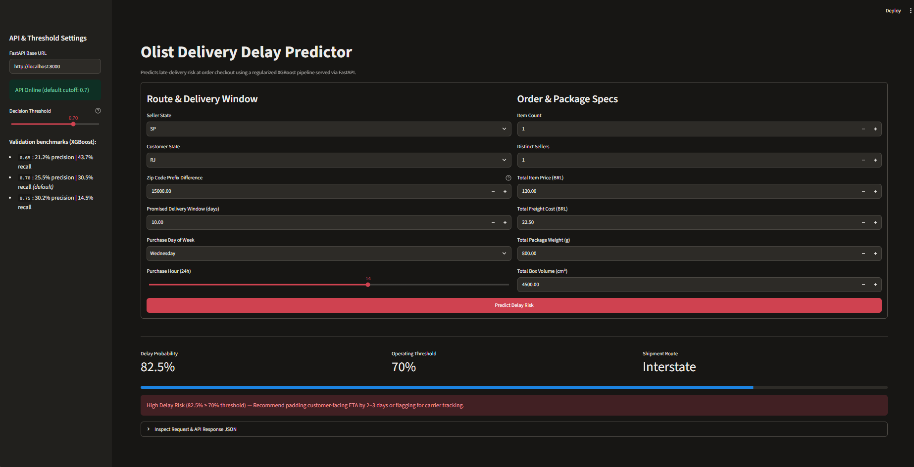
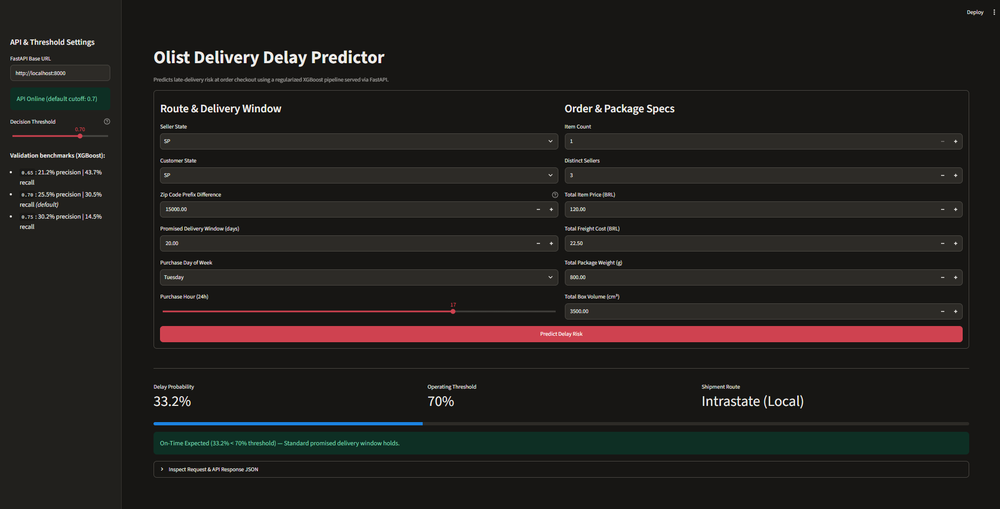
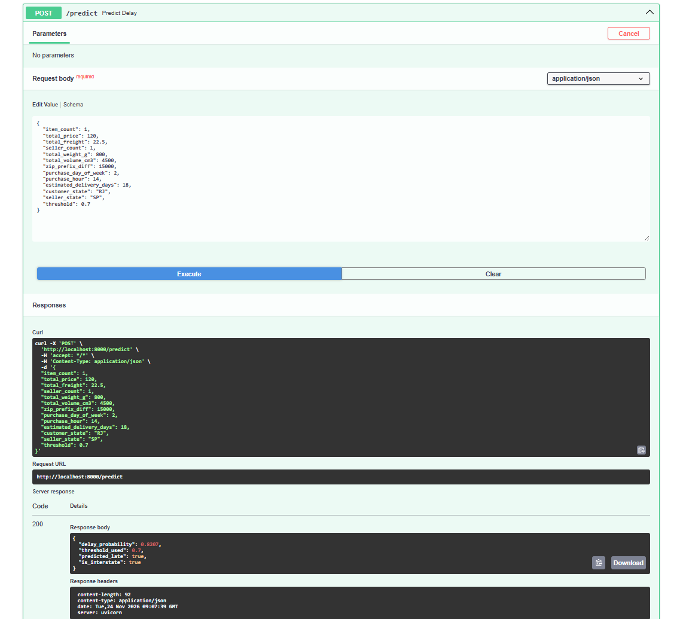

# Olist E-Commerce Delivery Delay Predictor

An end-to-end machine learning system that predicts late-delivery risk at the moment an order is placed using the Brazilian Olist e-commerce dataset. Built with **PostgreSQL**, **SQLAlchemy**, **scikit-learn**, **XGBoost**, **FastAPI**, and **Streamlit**, the project emphasizes chronological validation, leakage-free feature engineering, threshold calibration for class imbalance, and decoupled microservice deployment.

---

## System Architecture

```text
┌─────────────────────────┐      SQL Joins &       ┌──────────────────────────┐
│  PostgreSQL 16 + pgAdmin│ ───▶ Aggregations ───▶ │ Feature Pipeline         │
│  (Docker Compose :5433) │      (src/ingest.py)   │ (src/features.py)        │
└─────────────────────────┘                        └────────────┬─────────────┘
                                                                │
                                                  Chronological Split (64/16/20)
                                                                ▼
┌─────────────────────────┐      HTTP POST         ┌──────────────────────────┐
│  Streamlit Web Client   │ ───▶ /predict     ───▶ │ FastAPI Inference Server │
│  (app.py :8501)         │ ◀─── JSON Risk    ◀─── │ (src/api.py :8000)       │
└─────────────────────────┘                        └────────────┬─────────────┘
                                                                │
                                                   Loads Serialized Pipeline
                                                                ▼
                                                   ┌──────────────────────────┐
                                                   │ ColumnTransformer +      │
                                                   │ Regularized XGBoost      │
                                                   │ (models/*.joblib)        │
                                                   └──────────────────────────┘
```

---

## Key Engineering & Logistics Insights

1. **Destination Geography Outweighs Physical Package Dimensions**
   * Adding package weight (`total_weight_g`) and box volume (`total_volume_cm3`) from the `products` table provided minimal predictive lift compared to origin/destination states and cross-border routing (`is_interstate`).
   * **The Rio de Janeiro (`RJ`) Bottleneck:** Despite bordering São Paulo (`SP`), `customer_state_RJ` emerged as XGBoost's #1 most important split feature (`15.4%` importance, positive log-odds weight), reflecting last-mile urban carrier congestion compared to neighboring southeastern hubs (`SP`, `MG`, `PR`), which all strongly reduce delay risk.
   * **Directional Hub Asymmetry:** `customer_state_SP` carries a strong negative delay weight (orders delivered inside São Paulo stay within Brazil's fastest local logistics hub), whereas `seller_state_SP` carries a positive weight (São Paulo merchants ship nationwide across long-haul routes).

2. **Preventing Temporal Leakage (`purchase_month`)**
   * In initial experiments on a chronological split, tree models allocated **22.6%–35%+** of split importance to `purchase_month`, memorizing period-specific historical disruptions that failed to generalize to later months (`Val ROC-AUC: 0.6172`).
   * Removing `purchase_month` and one-hot encoding `customer_state` and `seller_state` forced the model to learn structural logistics patterns, lifting XGBoost `Val ROC-AUC` to **`0.7210`** (and **`0.7309`** after regularization).

3. **Calibrating Decision Thresholds Under Class Imbalance**
   * Because only `~8–9%` of orders arrive late, training XGBoost with `scale_pos_weight` stretches predicted probabilities upward (`median: 0.471`, `90th percentile: 0.697`). Leaving the classifier at a default `0.50` cutoff flags **43.1%** of all orders (`6,656 / 15,436`) at `13.7%` precision.
   * Sweeping thresholds on the validation set identified **`0.70`** as a balanced operational cutoff: it isolates the top **9.7%** highest-risk orders (`1,496 / 15,436`) while capturing **30.5%** of all delays at **25.5% precision** (>3× the `8.10%` baseline late rate).
   * **Business Application:** At checkout, orders crossing `0.70` can be dynamically padded by **+2 to +3 days** in the customer-facing ETA to prevent broken delivery promises without triggering false-alarm warnings on the 3-in-4 flagged orders that still arrive on time.

4. **Honest Evaluation & Temporal Distribution Shift on `X_test`**
   * Across the chronological split (`96,470` delivered orders sorted by `order_purchase_timestamp`), the actual late rate declined steadily over time: **Train (`9.00%`) → Validation (`8.10%`) → Test (`5.29%`)**.
   * While regularized XGBoost eliminated training overfitting (`Train ROC-AUC: 0.7333` vs. `Val ROC-AUC: 0.7309`), evaluating once on the untouched final 20% time slice yielded **`Test ROC-AUC: 0.6434`**. As carrier backlogs eased and Olist lengthened promised `estimated_delivery_days` in late 2018, a model calibrated on earlier high-delay months over-predicted late risk on the calmer test period—highlighting why time-aware evaluation and periodic threshold recalibration are critical in production logistics.

---

## Model Benchmarks & Validation Results

All models were trained on the first **64%** of orders (`61,740` rows) and evaluated on the subsequent **16%** validation window (`15,436` rows) before locking in the final model and threshold for the untouched **20%** test set (`19,294` rows).

### Model Comparison (Validation Set)

| Model | Key Configuration | Train ROC-AUC | Val ROC-AUC | Notes |
| :--- | :--- | :---: | :---: | :--- |
| **Dummy Classifier** | `strategy="most_frequent"` | 0.5000 | 0.5000 | Predicts all on-time (`91.9%` accuracy, `0.00` recall) |
| **Logistic Regression** | `class_weight="balanced"`, `StandardScaler` + `OneHotEncoder` | 0.6960 | **0.7455** | Strong linear baseline; captures additive state + ETA effects |
| **Random Forest** | `n_estimators=200`, `class_weight="balanced"` | 1.0000 | 0.7103 | Overfits training rows without depth constraints |
| **XGBoost (Unregularized)** | `max_depth=5`, `lr=0.05`, `scale_pos_weight` | 0.7893 | 0.7210 | Mild overfitting gap (`0.068` Train–Val spread) |
| **XGBoost (Selected)** | `max_depth=3`, `subsample=0.8`, `colsample_bytree=0.8`, `lr=0.05` | **0.7333** | **0.7309** | Eliminates overfitting (`0.0024` spread); selected for deployment |

### Threshold Trade-Off Sweep (Regularized XGBoost on `X_val`)

| Probability Cutoff | Precision | Recall | F1-Score | Orders Flagged | Operational Use Case |
| :---: | :---: | :---: | :---: | :---: | :--- |
| `0.60` | 18.4% | 56.0% | 0.277 | 3,805 / 15,436 (24.7%) | Broad monitoring when false positives are low-cost |
| `0.65` | 21.2% | 43.7% | **0.285** | 2,582 / 15,436 (16.7%) | Peak F1; aggressive automated ETA padding |
| **`0.70` (Default)** | **25.5%** | **30.5%** | 0.277 | **1,496 / 15,436 (9.7%)** | **Balanced default: <10% alert volume, >3× baseline precision** |
| `0.75` | 30.2% | 14.5% | 0.196 | 600 / 15,436 (3.9%) | High-confidence queue for manual logistics intervention |

---

## Application Preview

### Streamlit Risk Simulator (`app.py`)
Users can configure route states, zip code prefix gaps, promised delivery windows, package specs, and adjust the operating threshold in real time against the FastAPI backend.

| High-Risk Interstate Route (`SP` → `RJ`) | Low-Risk Intrastate Route (`SP` → `SP`) |
| :---: | :---: |
|  |  |

### FastAPI Swagger Documentation (`src/api.py`)
Pydantic schema validation enforces field bounds and state codes at `/predict`, returning delay probability, threshold applied, late flag, and interstate routing status.



---

## Project Structure

```text
olist-delay-predictor/
├── app.py                      # Streamlit frontend client (port 8501)
├── compose.yaml                # Docker Compose setup for PostgreSQL 16 & pgAdmin 4
├── requirements.txt            # Python dependencies
├── .env.example                # Environment variable template
├── data/
│   └── raw/                    # Raw Olist CSV tables (mounted into pgAdmin)
├── models/                     # Serialized model artifacts (*.joblib gitignored)
├── notebooks/                  # Exploratory data analysis notebooks
├── sql/
│   ├── 01_schema.sql           # Relational table definitions
│   ├── 02_eda_order_overview.sql
│   ├── 03_feature_discovery.sql
│   └── 04_products_eda.sql
├── src/
│   ├── api.py                  # FastAPI REST service (/health, /predict)
│   ├── config.py               # Environment configuration loader
│   ├── db.py                   # SQLAlchemy PostgreSQL engine
│   ├── ingest.py               # SQL joins across orders, customers, items, products, sellers
│   ├── features.py             # Leak-free checkout feature engineering & chronological split
│   └── train.py                # Model training, validation sweeps, test eval & joblib export
└── tests/
```

---

## Local Setup & Running the Stack

### 1. Configure Environment & Start PostgreSQL
Copy `.env.example` to `.env` and start the database services (`PostgreSQL` on port `5433`, `pgAdmin` on port `8080`):

```bash
cp .env.example .env
docker compose up -d
```

Initialize the schema using `sql/01_schema.sql` and load the raw Olist CSVs from `data/raw/` into PostgreSQL via pgAdmin (`http://localhost:8080`) or `psql`.

### 2. Install Python Dependencies

```bash
python -m venv .venv
source .venv/bin/activate
pip install -r requirements.txt
```

### 3. Train & Export the Model Artifact
Run the training pipeline to evaluate models on the chronological split and serialize `models/xgb_delay_predictor.joblib`:

```bash
python -m src.train
```

### 4. Start the FastAPI Backend & Streamlit Frontend
In terminal 1, start the prediction API (`http://localhost:8000/docs`):

```bash
uvicorn src.api:app --reload
```

In terminal 2, launch the Streamlit UI (`http://localhost:8501`):

```bash
streamlit run app.py
```